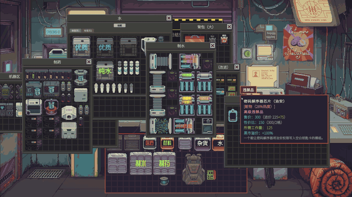

# Container Window Finder / 箱子窗口定位

A small mod for **Probably Stolen – Cyberpunk Shopkeeper Sim** that helps you find which container window is open.
《深空当铺：可能是偷的》小 mod：帮你找到某个箱子对应的已打开窗口。



**Steam Workshop:** https://steamcommunity.com/sharedfiles/filedetails/?id=3838289931

## Features / 功能

- **Hover** a container whose window is open → that window briefly highlights. Layering is unchanged; a window behind others stays behind.
- **Click** the container once → the window highlights and jumps to the front (uses the game's own `PixelWindow.ToFront()`).
- **X-ray outline** → a thin dashed border shows the full window outline, even where it is covered by other windows or the item tooltip. Covered content is not changed.
- **Drag** an item over a container whose window is open → that window highlights too.
- The glow stays only while the mouse is on the container and disappears when it leaves. Double-click, drag and box selection work as before.
- **Settings** (gear button next to the mod in the main-menu Mods list): fade-out time 0–3 s, brightness, hover/click colors, window tint, dashed outline and drag highlight on/off.

- **悬停**在已打开窗口的箱子上 → 对应窗口短暂高亮，前后顺序不变，被挡住的仍在后面。
- **单击**箱子 → 窗口高亮并跳到最前面（调用游戏自带的 `PixelWindow.ToFront()`）。
- **透视边框** → 细虚线显示窗口完整轮廓，被其他窗口或物品信息面板挡住的部分也能看到，被挡内容不变。
- **拖着物品**经过已打开窗口的箱子 → 对应窗口也会高亮。
- 只在鼠标停在箱子上时发光，移开立即消失。双击、拖拽、框选照旧。
- **设置**（主菜单 Mods 里点 mod 旁边的齿轮）：淡出时间 0–3 秒、亮度、悬停/单击颜色、窗口淡色填充、透视虚线框和拖动高亮开关。

No capabilities required (empty `<Capabilities />`), no save changes. / 不需要特殊权限，不修改存档。

## Install / 安装

- Workshop: subscribe → in game open **Mods** → select → **Activate** → restart.
- Manual: copy `manifest.xml` + `ContainerWindowFinder.dll` into `Probably Stolen\Mods\ContainerWindowFinder\`, then activate and restart.

## Build / 编译

Requires the .NET SDK (6+) and your own copy of the game. Game assemblies are **not** included in this repo.

```
dotnet build src -c Release -p:GameManaged="C:\Program Files (x86)\Steam\steamapps\common\Probably Stolen\Probably Stolen_Data\Managed"
```

Output: `src/bin/Release/netstandard2.1/ContainerWindowFinder.dll` (+ `manifest.xml`).

## Tuning / 调整

Most options are in the in-game settings panel (`src/Settings.cs`). Line widths are constants at the top of `src/WindowFinderBehaviour.cs`.

## License

MIT. Not affiliated with the game's developers.
